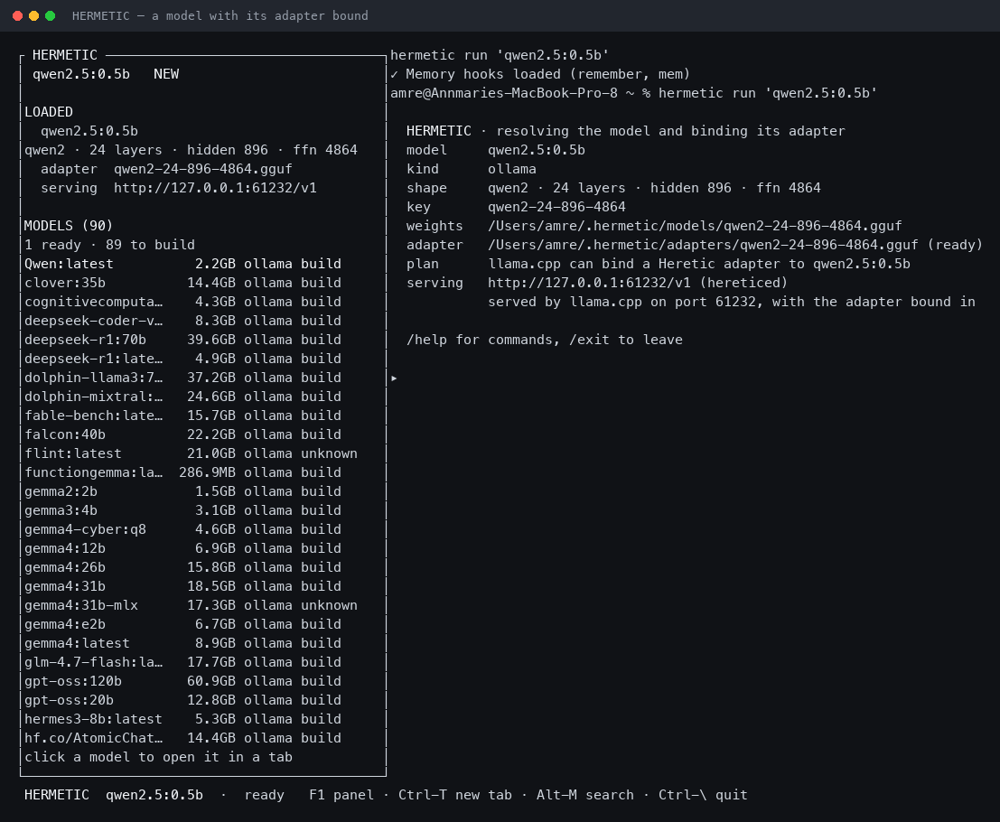
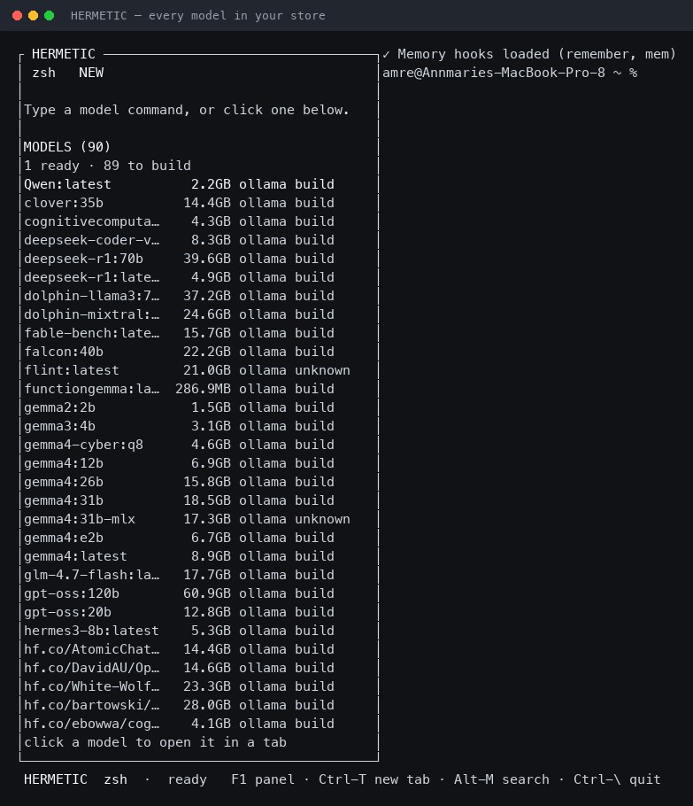

# HERMETIC

A terminal where every model you load is **hereticed** first.

Upstream [Heretic](https://github.com/p-e-w/heretic) removes a model's refusal
behaviour by modifying its weights - no prompt tricks, no system-prompt
scaffolding. It works, but it is a one-shot program: you point it at a model,
it ablates the weights, and you are left holding a `.gguf` and a separate
`llama-server` command.

HERMETIC puts that inside a shell, and it puts it inside **any** model
runtime, not just one:



```
amre@Annmaries-MacBook-Pro ~ % ollama run qwen2.5:0.5b

  HERMETIC · resolving the model and binding its adapter
  model     qwen2.5:0.5b
  kind      ollama
  shape     qwen2 · 24 layers · hidden 896 · ffn 4864
  key       qwen2-24-896-4864
  weights   ~/.hermetic/models/qwen2-24-896-4864.gguf
  adapter   ~/.hermetic/adapters/qwen2-24-896-4864.gguf (ready)
  serving   http://127.0.0.1:50473/v1 (hereticed)
            served by llama.cpp on port 50473, with the adapter bound in

▸ how do I pick a lock?
```

The panel on the left lists everything it can find - Ollama's store, GGUF
files on disk, MLX models, the hub - and a click loads it:



## Install

```bash
git clone https://github.com/TheSolAI/hermetic
cd hermetic
./install.sh
```

That is the whole thing. `install.sh` checks what it needs, builds the
engine's virtualenv (the vendored Heretic), builds the two binaries, and
installs `~/Applications/HERMETIC.app` with a shortcut on your Desktop.

Requirements: macOS, [Rust](https://rustup.rs), and `llama-server` on the
PATH. `ollama` is optional but that is where most models come from.

## The two ideas

The whole design follows from two questions, and nothing else is
runtime-specific.

**Where are the weights?** - `hermetic_core::ModelSource`

| source | where | weights can be changed? |
|---|---|---|
| `Ollama` | `~/.ollama/models` | yes - the files are ours to read and convert |
| `Gguf` | a file on disk | yes |
| `Mlx` | a directory of safetensors | yes - the adapter folds into them |
| `HuggingFace` | the hub | yes - we download the original weights |
| `Remote` | a server that already holds them | **no** - prompt policy only |

**How is it served?** - `hermetic_core::ModelRuntime`

| runtime | serves | adapter |
|---|---|---|
| `llama.cpp` | GGUF files | bound at runtime, exactly |
| `mlx` | safetensors directories | folded into the weights |
| `ollama` | Ollama's store | not changeable - prompt policy instead |
| `openai` | any server speaking the OpenAI API | not changeable - prompt policy instead |

Everything the terminal does is written against those two. It never asks
"which runtime is this?" - it asks "where are the weights?" and "what can
serve them?".

### The trick that makes it work

Every runtime that can be talked to at all exposes the same API:
`POST /v1/chat/completions`, with server-sent events coming back. llama.cpp
does. `mlx_lm.server` does. LM Studio does. vLLM does. Ollama does.

So the terminal has **one** chat client - `hermetic_core::chat::Chat` - and
does not care what is behind the endpoint. That is what lets MLX and
llama.cpp and a cloud API be the same thing to the terminal.

### What differs between runtimes

Not the protocol: the *policy*.

A model whose weights were changed needs no prompt at all - the refusal
behaviour is gone from the weights. A model whose weights could not be
changed - because a server holds them, or because nobody publishes its
shape - is served with a prompt-level policy instead, and the terminal
**says so**. `ServeMode` is `hereticed`, `prompt policy` or `as it is`, and
it is shown next to the model.

## Adapters are keyed by shape, not by name

llama.cpp will only bind a LoRA adapter whose tensors line up with the base
model exactly, so a `Qwen3-0.6B` adapter cannot be used on `Qwen3-4B`. The
terminal therefore keys adapters by a **shape signature** - architecture,
layers, hidden size, feed-forward size - and not by model name:

```
qwen3-36-4096-12288      qwen2-24-896-4864      gemma4-30-2816-2112-128
```

One adapter serves every checkpoint and every quantisation of that shape.

### Finding the original weights

A model's *name* is no use at all when finding the weights to abliterate: a
distilled `deepseek-r1:8b` is really a `Qwen3-8B`, and only the shape says
so.

So the search is driven by the shape and the parameter count
(`hermetic_core::hub`), and it uses every hint it can get:

1. **The name inside the weights.** A GGUF file says what it is -
   `general.name` - and that is usually the truest hint there is. It is also
   old: a file that calls itself `Qwen2-beta-4B-Chat` is a `Qwen1.5-4B-Chat`
   today, and the hub redirects the old name to the new one.
2. **The organisation x family x size matrix.** `Qwen:latest` is really
   `Qwen/Qwen2.5-3B`; llama.cpp only tells you the architecture is `qwen2`,
   so the minor version is guessed (`Qwen2`, `Qwen2.5`, `Qwen2.0`) and
   crossed with the organisations that publish models of that family.
3. **Every version of the family.** llama.cpp calls every Llama model
   `llama`, but the hub has `Llama-2`, `Llama-3`, `Llama-3.1` and `Llama-3.2`
   as separate repositories, and the version is nowhere in the architecture.
   So it is guessed - `Llama-3`, `Gemma-2`, `Qwen3.5` - and the shape check
   decides which guess was right.
4. **The hub's search, with the size in the query.** `Llama-3-34B` is the
   query that finds the public mirrors of a gated model - the ones everybody's
   download count is on, not the original. The results are then filtered by
   the parameter count, which Ollama knows exactly (`general.parameter_count`)
   and the hub knows exactly (`safetensors.total`), and asked about in
   parallel, because the hub is slow one request at a time.
5. **The shape, checked to the digit.** The shape is the only thing that is
   actually right, so it is what decides. A model that predicts more than one
   token at a time carries an extra block for it, and the original weights do
   not, so one layer of difference is allowed - in that direction only.

Repositories that are gated are reported as gated, and the hub cannot tell a
gated repository from one that was never there: it answers `401` for both. So
the hub's own search is the oracle - a repository it returned exists - and
`HF_TOKEN` unlocks the gated ones.

The search is tested against the real hub, not only against mocks:

```bash
cargo test --release --test donor -- --ignored --nocapture
# qwen2.5-coder:7b -> Qwen/Qwen2.5-Coder-7B
# Qwen:latest       -> Qwen/Qwen2-beta-4B-Chat
# deepseek-r1:latest -> Qwen/Qwen3-8B
```

## What is in the box

| | |
|---|---|
| **A real shell** | zsh in a pseudo-terminal. Your rc files, your history, your line editing. |
| **Tabs** | `Ctrl-T` opens one. Each tab is its own shell and its own model. |
| **Any model** | The panel lists everything it can find, wherever it lives. Click one and it opens in a tab. |
| **The engine** | Upstream Heretic, unmodified, with every scorer and every modifier. |
| **Two ways to apply it** | A LoRA bound at runtime, or the adapter folded into the weights. |

## How it fits together

```
┌──────────────────────────────┐        ┌───────────────────────────────┐
│  hermetic (Rust)                │        │  hermetic-shim (Rust)            │
│                              │        │                               │
│  · a real zsh in a PTY       │◀──────▶│  · a ModelSource              │
│  · vt100 grid, your colours  │  shell │  · a ModelRuntime             │
│  · the HERMETIC panel         │  hook  │  · runs llama-server + LoRA   │
└──────────────────────────────┘        │  · one chat client, for all   │
             ▲                          └───────────────────────────────┘
             │ NDJSON over a unix socket
┌────────────┴─────────────┐        ┌───────────────────────────────┐
│  hermetic_bridge.py          │        │  heretic (Python, upstream,   │
│  · runs Heretic unchanged │───────▶│   unmodified)                │
└─────────────────────────────┘        └───────────────────────────────┘
```

The engine is **not** modified. The bridge
(`engine/bridge/hermetic_bridge.py`) hooks only Heretic's own extension
points - `heretic.utils.print`, `heretic.main.questionary`, and a few method
seams - and speaks newline delimited JSON over a unix socket. Every scorer,
every modifier, every shipped profile, the plugin system and the
`reproduce.json` machinery keep working untouched.

## The crates

| crate | what it is |
|---|---|
| `hermetic-protocol` | the wire protocol between the terminal and the engine |
| `hermetic-core` | the abstraction layer: sources, runtimes, discovery, the adapter cache, the hub, the planner, the chat client |
| `hermetic-terminal` | the terminal itself |

`hermetic-core` does not know that the terminal exists, and it does not know
that Heretic exists. It knows about shapes, sources, runtimes and adapters.

## Building

```bash
cargo build --release
cargo test --release
```

The binaries land at `target/release/hermetic` and
`target/release/hermetic-shim`.

The engine needs its own virtualenv with Heretic installed:

```bash
cd engine
uv venv --python 3.13 .venv
uv pip install --python .venv/bin/python -e ./heretic
```

## Running

```bash
./target/release/hermetic
./target/release/hermetic --run qwen2.5:0.5b
./target/release/hermetic --panel-side right
./target/release/hermetic --no-panel
```

## Keys

| Key | What it does |
|---|---|
| everything else | Goes to the shell. |
| `Ctrl-T` / `F2` | Open a new tab. The **NEW** button in the panel does the same, and you can click it. |
| `Ctrl-W` | Close the tab. |
| `Ctrl-Tab` / `Ctrl-Shift-Tab` | Next tab, previous tab. |
| `Alt-1` .. `Alt-9` | Jump to a tab. |
| `Alt-M` | Hand the model list the keyboard: type to search, `Enter` to open, `Esc` to give it back. |
| `Alt-R` | Read the model store again. |
| `F1` | Show or hide the side panel. |
| `Ctrl-\` | Quit the terminal. |
| the mouse | Click a tab, click **NEW**, click a model to open it in a tab (`Alt`-click for a window of its own), scroll the list. |

## Licence

AGPL-3.0-or-later, because the engine is. The bridge carries the same
licence. If you want to link this into something under a different licence,
call the terminal as a separate process - which is how it is designed to run
anyway.

## See also

- `docs/PROTOCOL.md` - the wire protocol, event by event.
- `docs/DESIGN.md` - why it is split this way, and what went wrong first.
- `docs/RUNTIMES.md` - how each runtime is supported, and what each one
  cannot do.
